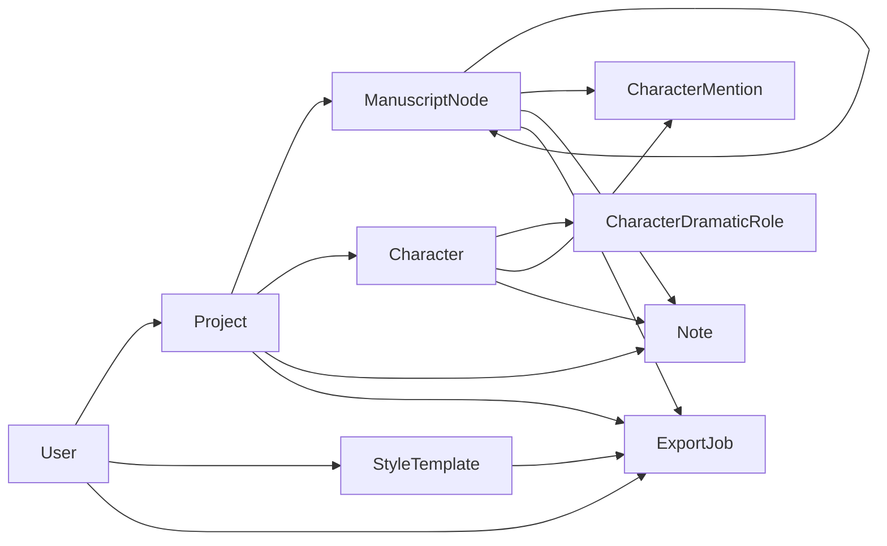

# Arquitectura actual: auditoria v01

Fecha: 2026-11-06, America/Mexico_City. Alcance: codigo local, configuracion,
migraciones en disco y comprobaciones no destructivas. Referencia Git: `7f51f2c`,
mas los cambios locales de reordenamiento que ya existian al iniciar la auditoria.
El codigo del directorio de trabajo es la fuente de verdad de este informe.

## Resultado y limites de la evidencia

La base es un monolito Django coherente y reutilizable. Contiene nueve modelos de
dominio, siete migraciones iniciales propias y 177 metodos de prueba. No contiene
versiones de escenas, suscripciones, pagos ni entidades de construccion de mundos.
`admin_dashboard` sigue siendo una app vacia.

El chequeo local de Django y la compilacion de los 32 templates finalizaron bien.
No se pudo comprobar la base de datos, ejecutar la suite en PostgreSQL ni obtener
respuesta de Celery: Podman no tenia un socket disponible. No se puede afirmar
que las migraciones esten aplicadas, que no haya pendientes en la base ni que los
datos existentes cumplan las nuevas reglas. Los resultados satisfactorios de
fases anteriores no se cuentan como pruebas ejecutadas en esta auditoria.

Solo se crea documentacion en esta fase. No se ejecutaron migraciones, semillas,
borrados, reinicios de volumen ni modificaciones de datos de negocio. El respaldo
de directorio fue confirmado por el propietario; esta auditoria no verifico que
incluya los volumenes nombrados de PostgreSQL y media.

## Plataforma y ejecucion

| Componente | Evidencia actual |
| --- | --- |
| Python | `pyproject.toml`: >=3.12; imagen `python:3.12-slim` |
| Django | Rango >=5.2,<5.3; lock y entorno local: 5.2.15 |
| PostgreSQL | `postgres:16-alpine`, volumen `postgres_data` |
| Driver | `psycopg` y `psycopg-binary` 3.3.4 en lock/local |
| Redis | Servidor `redis:7-alpine`, AOF y volumen `redis_data`; cliente Python 6.4.0 |
| Celery | 5.6.3 en lock/local; broker DB 0 y resultados DB 1 de Redis por defecto |
| HTTP | Gunicorn 23.0.0, puerto local configurable, por defecto 8000 |
| Exportadores | python-docx 1.2.0, WeasyPrint 69.0, EbookLib 0.20 |
| Paquetes | uv 0.11.15 en Dockerfile, `uv sync --locked --no-dev --no-install-project` |
| TUI | Textual 6.12.0 en grupos `dev` y `tui`; `control_tui.bat` y `tools/control_tui.py` |

`compose.yaml` tiene web, worker, beat, postgres y redis. Web/worker comparten
`media_data`; web dispone de `static_data`. El repositorio se monta en `/code`.
La imagen ejecuta `appuser`; la preferencia operativa sigue siendo Podman rootless
con compatibilidad Docker Compose. No se pudo verificar el runtime rootless hoy.

PostgreSQL y Redis tienen healthchecks, pero `depends_on` usa la forma simple:
no expresa espera por estado saludable. No hay healthcheck de web/worker, limites
de memoria/CPU ni politica de reinicio declarados. El worker tiene concurrencia
configurable, por defecto 2. Beat usa un fichero en `/tmp` y un calendario vacio.

La configuracion se divide en base/dev/prod y lee variables con `os.getenv`.
Compose inyecta `.env`; ejecutar Python localmente no carga ese archivo por si
solo. No se inspeccionaron sus secretos. `.env.example` es de desarrollo.
SECRET_KEY y credenciales tienen valores de reserva de desarrollo; prod no falla
si faltan. Las opciones HTTPS/cookies seguras tienen valor de reserva falso.

`LANGUAGE_CODE=es-mx`, idiomas es-mx/en-us, zona America/Mexico_City, I18N y TZ
activos. Hay LocaleMiddleware y textos traducibles. `preferred_locale` y
`User.timezone` se guardan pero no se activan por usuario en las peticiones.
No hay configuracion explicita de validadores de contrasena, correo ni Stripe.
STATIC_ROOT/MEDIA_ROOT estan separados; servir estaticos en produccion y proxy
TLS siguen pendientes. En DEBUG se sirve todo MEDIA_ROOT mediante una ruta sin
autorizacion por propietario (`app/config/urls.py:24`).

## Modelos y relaciones

Las relaciones de borrado descritas a continuacion son las declaradas al ORM.
No debe interpretarse `on_delete` como una politica de conservacion ni como una
garantia de limpieza de archivos fisicos.

| Modelo / tabla | Datos y relaciones reales | Validaciones e indices |
| --- | --- | --- |
| `accounts.User` / `accounts_user` | AbstractBaseUser + PermissionsMixin; email, secondary_email, name, display_alias, preferred_locale, timezone, user_type, status, is_active, is_staff, last_login, fechas; grupos/permisos Django | Email unico; manager usa hashing Django. Tipos FREE/PREMIUM/BUSINESS_ADMIN/TECH_ADMIN y estados ACTIVE/FROZEN/PENDING_DELETION/DELETED. No unicidad normalizada por minusculas ni vinculacion automatica status/is_active |
| `projects.Project` / `projects_project` | FK User CASCADE; nombre, descripcion, language, locale, status y fechas de congelamiento/borrado | Indices (user,status), (user,-created_at). Limite FREE=1, PREMIUM=10, otros sin limite en metodos y formulario. No restriccion transaccional del cupo |
| `manuscripts.ManuscriptNode` / `manuscripts_manuscriptnode` | FK Project CASCADE, padre propio PROTECT nullable; tipo, titulo obligatorio, content en todos los tipos, status, position nullable, is_publishable, word_count, fechas | `save()` calcula palabras y llama full_clean. Valida proyecto, ciclos, mismo proyecto y posicion positiva; NO jerarquia de tipos. Indices (project,parent,position), (project,node_type), (project,status) |
| `characters.Character` / `characters_character` | FK Project CASCADE; nombre, alias, imagen, importancia, rol narrativo, rol personalizado, descripciones fisica/psicologica, biografia, motivaciones, objetivos, miedos, virtudes, defectos, arco, notes, completion_status, fechas | full_clean al guardar; completion_percentage calculado. Indices (project,name), (project,importance), (project,narrative_role) |
| `CharacterDramaticRole` / `characters_characterdramaticrole` | FK Character CASCADE; role, custom_role, fechas; varios por personaje | Limpia custom_role salvo OTRO. No restriccion unica para papeles repetidos |
| `CharacterMention` / `characters_charactermention` | FK Character CASCADE y FK ManuscriptNode CASCADE; mention_type, fechas | Valida mismo proyecto y duplicado (character,node,mention_type) por consulta; sin UNIQUE en base. Tipos APPEARS/MENTIONED/POV/NARRATOR/IMPORTANT_FOR_SCENE |
| `notes.Note` / `notes_note` | FK Project CASCADE, node SET_NULL opcional y character SET_NULL opcional; tipo, titulo, texto, estado, prioridad, fechas/completed_at | Valida mismo proyecto; sincroniza completed_at. Indices project+note_type/status/priority/-updated_at |
| `styles.StyleTemplate` / `styles_styletemplate` | FK User CASCADE nullable; is_system, nombre/descripcion, fuentes, tamanos, margenes, separador, opciones de indice/paginas, config_json, fechas | full_clean valida propietario segun is_system, numeros positivos/no negativos y JSON objeto. Indices (is_system,name), (user,name), font_category |
| `exports.ExportJob` / `exports_exportjob` | FK User/Project CASCADE, root_node SET_NULL opcional, style_template PROTECT; formato, estado, file, error_message y fechas | clean valida propietario/proyecto/raiz/estilo, invocado por formulario, no por save del modelo. Indices (user,project,-created_at), (status,format), created_at |

Tambien existen las tablas propias de auth, contenttypes, sesiones y admin de Django.
No hay restricciones `Meta.constraints` en los modelos de dominio actuales.
Las FK, PK, `email unique` y comprobaciones derivadas de tipos positivos si
aportan restricciones de esquema; choices y la mayor parte de reglas viven en
Python. `update()`/`bulk_update()` no usan esos `save()`.

El grafo indica referencias, no todas las politicas de borrado. Su detalle esta
en la tabla anterior. `Character.notes` es texto de la ficha; `work_notes` es el
nombre inverso de las notas relacionadas. Se deben conservar ambos.

## Arbol, servicios y dependencias

`ManuscriptNode` admite BOOK, PART, CHAPTER, SCENE y FRAGMENT. Estados actuales:
PENDING, IN_PROGRESS, DRAFT, REVIEW, FINISHED, PUBLISHABLE y PUBLISHED.

`manuscripts/services.py` concentra movimiento y normalizacion. La matriz actual
permite BOOK -> PART/CHAPTER/SCENE/FRAGMENT; PART -> CHAPTER/SCENE/FRAGMENT;
CHAPTER -> SCENE/FRAGMENT; SCENE -> FRAGMENT. Cualquier tipo puede ir a raiz.
Esta matriz solo se aplica al movimiento. Crear/editar mediante ModelForm/admin
admite otras jerarquias si pasan las validaciones generales. Los tests de export
incluso incluyen una escena directamente bajo un libro y texto en libro/capitulo.
Esto demuestra compatibilidad del codigo, no presencia de esos casos en datos reales.

`move_node` usa atomic y select_for_update con select_related(project): bloquea
el nodo y tambien la fila del proyecto unido, ademas del nuevo padre. Sin embargo,
crear/editar no siguen un protocolo comun y `move_node_up/down` normalizan antes
de entrar en esa transaccion. No hay UNIQUE de posiciones y MAX+1 puede competir.
Una edicion con instancia antigua puede sobrescribir texto o parent/position.
El alcance de locks sobre joins corresponde a la semantica documentada de
[select_for_update](https://docs.djangoproject.com/en/5.2/ref/models/querysets/#select-for-update).

`build_tree_rows` y `ordered_project_nodes` construyen recorridos completos en
memoria. El primero alimenta templates; el segundo, exportacion y preview.
La seleccion de un subarbol tambien carga todo el proyecto, con su contenido.
El limite de preview se aplica despues de cargarlo. Los recorridos recursivos
no tienen defensa explicita frente a ciclos heredados; nodos sin raiz alcanzable
pueden desaparecer de la vista. `descendant_ids` consulta por nivel y usa seen.

Dependencias Python: projects -> accounts; manuscripts -> projects;
characters -> projects/manuscripts; notes -> projects/manuscripts/characters;
styles -> accounts; exports -> accounts/projects/manuscripts/styles.
Las vistas repiten `get_user_project` y condiciones de estado. No hay capa comun
de permisos de negocio ni de suscripcion. Son candidatos a extraerse con pruebas.

## Permisos e interfaz

Las vistas privadas usan login_required y filtran proyectos por propietario.
Los formularios limitan FK a objetos del proyecto; menciones verifican ambos
extremos. Logout, subir/bajar, restaurar proyecto y duplicar estilo usan POST;
los formularios incluyen CSRF. No hay colaboradores ni permisos compartidos.

| Operacion | Comportamiento actual |
| --- | --- |
| Crear/editar nodos, personajes, notas; gestionar menciones; mover nodos | Bloquea DELETED/PENDING_DELETION; FROZEN sigue siendo editable |
| Editar proyecto | Solo bloquea DELETED |
| Borrar nodo/personaje/nota | Confirma propietario, pero no bloquea por estado del proyecto; borrado fisico |
| Crear exportacion/preview | Bloquea DELETED/PENDING_DELETION; no depende de status del usuario |
| Descargar exportacion | Requiere propietario, DONE y file; FileResponse adjunto |
| Estilos | Ver sistema+propios; crear/editar/duplicar depende de user_type. Borrar propio no comprueba el tipo; estilo utilizado provoca PROTECT sin manejo en la vista |
| Administracion | Django admin, con is_staff y permisos estandar; user_type administrativo no concede permisos automaticamente ni limita acceso a manuscritos |

`User.status` por si solo no bloquea login ni escrituras. La autenticacion
estandar usa is_active. Aun no existe la distincion entre cuenta vencida de solo
lectura y cuenta deshabilitada para autenticacion.

Los templates son Django, sin SPA. Formularios y tablas usan un layout comun y
textos traducibles. Listas de proyectos, personajes, notas, estilos y exports
no estan paginadas. Hay select_related en notas/exports/menciones y prefetch de
papeles en personajes; no es correcto diagnosticar un N+1 general. Falta medir
consultas y memoria con datos grandes. El admin de menciones accede tambien al
proyecto del personaje: revisar prefetch/select_related con medicion.

## Exportaciones y archivos

`exports/services.py` selecciona/ordena nodos y genera HTML con CSS incluido.
DOCX y EPUB reutilizan ese orden, pero renderizan content directamente con sus
propios encabezados. PDF reutiliza el HTML mediante WeasyPrint. Notas y fichas
quedan fuera. No se filtra status ni is_publishable. Las fuentes y configuracion
de estilo siguen vivas: no hay snapshot del contenido ni del estilo solicitado.

Tareas registradas en codigo: `apps.exports.generate_export_job` y
`config.celery.debug_task`. La vista guarda ExportJob y llama `.delay()`; no hay
reconciliacion si falla publicar en Redis. La tarea cambia a PROCESSING sin
comparar estado, genera bytes/archivo y pasa a DONE o FAILED. No tiene token de
intento, exclusividad, recuperacion de PROCESSING abandonado ni notificaciones.
La captura de excepciones guarda su texto, sin logging explicito; fallos previos
al try no alcanzan esa transicion. Beat no ejecuta limpieza ni recordatorios.

Riesgo concreto: borrar el root_node de una exportacion en cola lo convierte en
NULL. El worker interpreta NULL como todo el proyecto y puede ampliar el alcance
solicitado (`exports/models.py:40`, `exports/services.py:69`). Otro riesgo es la
ruta DEBUG `/media/exports/<user>/<project>/<archivo>`: elude la vista privada de
descarga si se conoce o adivina la ruta. No se realizo una prueba HTTP hoy.

Imagenes: FileField con validador de extension y nombre UUID bajo characters/.
Sin comprobacion real de imagen ni limite de bytes propio. Reemplazar/borrar
registros no tiene un servicio de limpieza fisica. El volumen de media persiste,
pero no hay politica implementada de privacidad, cuotas, retencion o backups.

## Migraciones y validaciones de esta auditoria

En disco: `0001_initial` para accounts, projects, manuscripts, characters, notes,
styles y exports. admin_dashboard solo contiene `__init__.py` en migrations.
Dependencias: auth -> accounts -> projects -> manuscripts -> characters -> notes;
styles depende de accounts; exports depende de accounts/projects/manuscripts/styles.

| Comando solicitado | Resultado el 2026-11-06 |
| --- | --- |
| `podman compose ps` | Codigo 1; socket TCP 127.0.0.1:61427 rechazo conexion; confirmado tambien fuera del sandbox |
| `podman compose exec web python manage.py check` | Codigo 1 por el mismo socket; Django no se ejecuto |
| `podman compose exec web python manage.py showmigrations` | Codigo 1 por el mismo socket; aplicadas/pendientes desconocidas |
| `podman compose exec web python manage.py makemigrations --check --dry-run` | Codigo 1 por el mismo socket; no creo archivos |
| `podman compose exec web python manage.py test` | Codigo 1 por el mismo socket; ninguna prueba de la suite ejecutada |
| `podman compose exec worker celery -A config inspect ping` | Codigo 1 por el mismo socket; sin pong |

`podman machine list` devolvio `podman-machine-default`, WSL, 8 CPU, 2 GiB,
100 GiB y LAST UP `Never`. No se arranco ni se reconstruyo infraestructura.

Comprobaciones adicionales con el entorno instalado, sin sincronizar paquetes:

- `uv run --frozen --offline --no-sync python app/manage.py check`: codigo 0,
  `System check identified no issues (0 silenced).`
- `uv run --frozen --offline --no-sync python app/manage.py check --deploy --settings=config.settings.prod`:
  codigo 0, cinco avisos W004/W008/W009/W012/W016 (HSTS, redireccion SSL,
  clave y cookies seguras). Usa valores locales/de reserva, no evidencia de un
  despliegue de produccion ni lectura del `.env` de Compose.
- Compilacion mediante `get_template` de los 32 HTML: correcta, sin conectar DB.
- Comparacion offline con MigrationLoader(None), ProjectState y
  MigrationAutodetector: sin cambios al desactivar traducciones como hace
  makemigrations. Una primera inspeccion con traduccion activa genero diferencias
  de etiquetas; se descarto ese falso positivo. No informa estado aplicado.
- Parseo de uv.lock con tomllib: las diez dependencias comprobadas coinciden
  con las instaladas. No se actualizo el lock ni se hizo auditoria de CVE.

| App | Metodos test_ encontrados | Cobertura observada en codigo |
| --- | ---: | --- |
| accounts | 8 | Manager, superusuario, defaults, login, registro y perfil |
| projects | 12 | Propiedad, cupos, borrado diferido, restauracion |
| manuscripts | 33 | Arbol, ciclos, permisos, movimiento, preservacion de notas/menciones |
| characters | 31 | Fichas, imagen, roles, menciones, propiedad y notas ligadas |
| notes | 20 | Asociaciones, estados, filtros, permisos y borrado |
| styles | 15 | Permisos, validacion y semillas idempotentes |
| exports | 58 | Cuatro formatos, adjuntos, orden/subarbol, exclusion de notas y preview |
| Total | 177 | Conteo estatico, no resultado de ejecucion |

Son pruebas Django TestCase, sin pytest ni TransactionTestCase. Las de exports
simulan `.delay()` o ejecutan `.run()` directamente y usan media temporal. No
demuestran entrega real por Redis, concurrencia, recuperacion tras caidas,
caducidad, privacidad de media ni restauracion de respaldos. El PDF se valida
por cabecera/bytes y HTML fuente, no mediante comparacion visual exhaustiva.

## Hallazgos prioritarios

El registro detallado y la evidencia por archivo estan en
[05-risk-register.md](05-risk-register.md). Antes de migrar se deben cerrar:
acceso privado a media, politica uniforme de escrituras/borrados, carreras de
edicion/orden, alcance estable e idempotencia de exportaciones y un inventario
real de datos en PostgreSQL. La nueva funcionalidad depende de esa base.

El README conserva instrucciones historicas de reinicio destructivo de volumen
y una lista de siguientes fases ya realizadas. No se modifico por el alcance de
esta auditoria; debe corregirse antes del procedimiento operativo de migracion.
