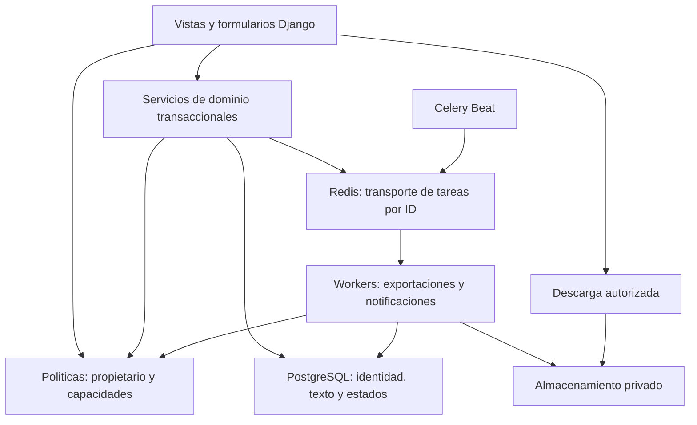
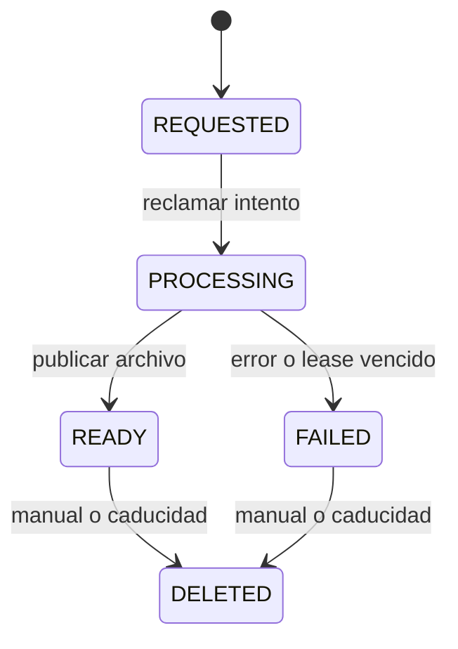

# Arquitectura objetivo propuesta

Fecha: 2026-11-06. Diseno para revision, no implementado. Las reglas expresamente
aprobadas en el anexo se respetan; las propuestas adicionales se identifican en
[06-decisions-required.md](06-decisions-required.md).

## Estructura y responsabilidades

Conservar Django 5.2, PostgreSQL, Redis, Celery/Beat, uv y Compose con Podman
rootless. Mantener un monolito con apps de dominio y templates Django. Web atiende
operaciones interactivas; workers procesan documentos/correos; Beat programa
trabajo idempotente. No se necesitan microservicios, un nuevo frontend ni un
motor de arbol externo para esta etapa.

Extraer politicas compartidas pequenas, empezando en projects/accounts. Usar
servicios para escrituras con varias filas: crear/mover nodo, editar/finalizar
version, solicitar/borrar exportacion, registrar pago y preparar una purga.
Las vistas, admin, comandos y tareas deben invocar las mismas reglas. No crear
una capa generica de repositorios ni un framework interno de permisos.

## Arbol narrativo con identidad estable

Conservar tabla, PK y FK de `ManuscriptNode`. Anadir `short_description` y permitir
`title` vacio solo en SCENE mediante formulario/servicio y restriccion local.
Descripcion disponible en todos los tipos; no inventar descripcion para registros
historicos ni deducirla del texto automaticamente.

| Tipo nuevo | Padre permitido | Hijos permitidos |
| --- | --- | --- |
| BOOK | Sin padre, dentro del proyecto | PART, CHAPTER |
| PART | BOOK del mismo proyecto | CHAPTER |
| CHAPTER | BOOK o PART del mismo proyecto | SCENE |
| SCENE | Exactamente un CHAPTER del mismo proyecto | Ninguno |
| FRAGMENT heredado | Conservar en compatibilidad hasta resolver D02 | Sin nuevas altas; no ocultar datos existentes |

El proyecto podra contener varios libros. Para proyectos nuevos se propone crear
el primer libro en la misma transaccion que el proyecto, una vez resuelta D01.
Proyectos historicos vacios o sin libro requieren tratamiento inventariado.
Mover cambia parent/position, nunca recrea nodos ni altera sus PK o proyecto.

Una funcion de validacion comun comprobara padre, tipo, pertenencia y ciclos,
incluido cambio de tipo con hijos existentes. Nuevas operaciones seguiran la
matriz estricta; excepciones historicas se registran y conservan durante migracion.
No basta con modificar la matriz del servicio de movimiento.

Protocolo propuesto: transaccion corta, bloquear Project primero, despues nodos
afectados en orden estable por PK; releer padres/descendientes; validar; modificar
y normalizar origen/destino. Todas las escrituras estructurales deben seguirlo.
Incluye creacion, edicion de parent/type/position y borrado. Separar edicion de texto
de cambios estructurales para que un formulario antiguo no deshaga un movimiento.

Posicion obligatoria >=1, orden determinista (position,created_at,pk). Tras sanear
datos, unicidad (project,parent,position) con NULLS NOT DISTINCT para raices en
PostgreSQL 16. Usar posiciones temporales libres para reordenar en dos pasos
dentro de una transaccion, evitando colisiones de una restriccion inmediata.
No anadir el UNIQUE antes de adaptar todos los escritores y normalizar empates.

Django permite restricciones condicionales y tratamiento de NULL para unicidad
en PostgreSQL 15+. No sustituyen las validaciones del arbol.
[Referencia de constraints Django 5.2](https://docs.djangoproject.com/en/5.2/ref/models/constraints/).

CHECK puede exigir BOOK sin padre, SCENE con padre, tipo permitido y titulo segun
tipo; no puede verificar el tipo/proyecto de otra fila ni recorrer ancestros.
Estas reglas se resolveran mediante servicios y, si se aprueba D16, triggers
acotados. No prometer un CHECK con joins.
[Limites de CHECK en PostgreSQL 16](https://www.postgresql.org/docs/16/ddl-constraints.html).

## Versiones independientes de escenas

Crear `SceneVersion` en manuscripts con los campos solicitados: id, scene,
version_number, editorial_stage, content, word_count, created_at, updated_at,
finalized_at. Proponer campos tecnicos `revision` (control de concurrencia),
`is_current_final` (definitiva vigente) y procedencia de migracion en un registro
de auditoria. FK scene a ManuscriptNode; validar que su tipo sea SCENE.

| Invariante | Mecanismo propuesto |
| --- | --- |
| Numero unico por escena | UNIQUE(scene,version_number), numero >=1 |
| Como maximo una definitiva vigente | UNIQUE(scene) WHERE is_current_final |
| Definitiva vigente coherente | CHECK: is_current_final implica editorial_stage=FINAL y finalized_at no nulo |
| Etapas y conteos validos | CHECK de DRAFT/REVIEW/FINAL, word_count>=0, revision>=1 |
| Historia final conservada | FINAL se hace inmutable en servicio/admin; reemplazar vigente solo cambia bandera, no contenido ni finalized_at |
| Version activa de edicion | FK nullable `ManuscriptNode.active_version`; validar misma escena. Para editar una FINAL se crea copia DRAFT |
| Relacion permanente | Mover la escena conserva id y SceneVersion.scene_id; notas/menciones siguen en la escena |

La etapa FINAL expresa un hito historico. `is_current_final` identifica cual de
esas versiones se publica hoy: puede haber varias FINAL historicas y cero o una
vigente. No usar UNIQUE de todas las versiones FINAL, pues destruiria esa historia.
`active_version` y definitiva vigente pueden ser distintas. El puntero activo
es por escena en esta fase de propietario unico, no un bloqueo permanente de UI.

Crear version bajo bloqueo de escena y asignar MAX(version_number)+1 dentro de
la transaccion; UNIQUE es defensa adicional. Crear un borrador copia el texto
elegido y deja intactos los anteriores. Promover a FINAL: bloquear escena, validar
revision esperada, retirar bandera anterior, finalizar la elegida y activar su
bandera en una sola transaccion. Dos promociones concurrentes no deben perder una
historia ni producir dos vigentes.

Cada guardado de DRAFT/REVIEW envia revision esperada. La actualizacion condicional
incrementa revision; si no afecta una fila, devolver conflicto (por ejemplo HTTP
409), conservar el texto enviado y ofrecer comparar/guardar como nueva version.
No usar solo updated_at ni reintentar sobrescribiendo. Una version anterior no
se elimina al crear otra; la retencion de cada autoguardado es una decision distinta
de este versionado y queda en D05.

Proponer PROTECT para SceneVersion.scene y active_version, con archivado de escenas
en el flujo normal. La purga definitiva futura debera romper referencias activas
de forma explicita, segun procedimiento auditado. No introducir cascadas que
eliminen historia al borrar accidentalmente una escena.

La migracion byte a byte, los estados antiguos, escenas vacias y contenido fuera
de escenas se detallan en [03-data-migration-plan.md](03-data-migration-plan.md).

## Construccion de mundos, referencias y personajes

Apps propuestas: geography, organizations, worldbuilding y references. Crear
solo cada app cuando se implemente su fase; todas sus entidades tienen FK Project,
fechas, permisos por propietario y servicios compartidos con la misma politica.

| Entidad | Propuesta de modelo y reglas |
| --- | --- |
| GeographicLocation | project, parent propio nullable, location_type, name, short_description, detailed_description y fechas. Tipos UNIVERSE/WORLD/CONTINENT/EMPIRE/KINGDOM/COUNTRY/PROVINCE/CITY. Padre mismo proyecto; sin ciclos; permitir saltos de nivel. Si se permite padre del mismo nivel u orden inverso depende de D08. Sin matriz rigida de niveles por defecto |
| Organization | project, name, organization_type, short_description, detailed_description y fechas. RELIGIOUS/POLITICAL/BROTHERHOOD/GUILD/OTHER |
| WorldbuildingEntry | project, category, title, short_description, content y fechas. POLITICS/RELIGION/HISTORY. Varias entradas por categoria; NO UNIQUE(project,category) |
| ReferenceMaterial | project, kind, title, description, autor/obra/editorial/ano/identificador bibliografico opcionales, external_url, file privado opcional, mime_type, size_bytes, checksum, nombre original y fechas. Tipos bibliografia/enlace/imagen/adjunto; sin exigir una subida para un libro citado |
| ReferenceAssociation | FK reference y un destino tipado: node, character, location, organization o worldbuilding_entry. CHECK exactamente un destino; UNIQUE por pareja referencia/destino, pertenencia al mismo proyecto en servicio. Referencia sin asociaciones pertenece al proyecto |
| CharacterOrganizationMembership | FK character/organization, descripcion de afiliacion y fechas; UNIQUE pareja en v01 si no se requiere historia de membresias |
| CharacterLocation | FK character/location, tipo de vinculo (residencia/origen/pertenencia por decidir), descripcion; evita duplicar nombres de lugares en la ficha |
| CharacterRelationship | FK origen/destino, tipo de relacion, descripcion; mismo proyecto y extremos distintos. Amistad simetrica usa pareja canonica; interes romantico puede ser direccional. Politica en D09 |

Preferir asociaciones con FK explicitas a GenericForeignKey para mantener
integridad referencial. La tabla con destinos opcionales tiene un conjunto
acotado y conocido; anadir un destino exige migracion, un coste aceptable.

Conservar los campos, IDs, importancia narrativa, roles y papeles dramaticos de
Character. PROTAGONISTA/ANTAGONISTA/DEUTERAGONISTA ya existen: no crear booleanos
duplicados. `INTERES_ROMANTICO` como papel dramatico se conserva; el vinculo a otro
personaje se representa con CharacterRelationship, sin inferirlo de ese papel.
Imagenes adicionales mediante referencias asociadas; migrar la imagen actual
solo despues de verificar copia, checksum y permisos, manteniendo compatibilidad.

Almacenamiento privado separado de rutas publicas, descarga por vista autorizada
o URL firmada de vida corta si posteriormente se adopta almacenamiento de objetos.
En v01 basta un volumen privado compartido web/worker, fuera del servidor de media
publico. Validar tipo real, extension, tamanos y cantidad total; nombres aleatorios,
sin confiar en nombre/MIME del cliente. Parametros propuestos: REFERENCE_MAX_FILE_BYTES,
CHARACTER_IMAGE_MAX_BYTES y PROJECT_STORAGE_QUOTA_BYTES; valores pendientes D07.
Los umbrales de memoria de subida no son limites de archivo. No descargar URLs
arbitrarias en el servidor; enlaces son metadatos. No incluir secretos o texto de
manuscrito en logs; revisar renderizadores antes de admitir recursos externos.

## Seleccion de contenido y exportaciones

Crear un unico servicio de seleccion que devuelva un documento de exportacion
neutral (bloques tipados, jerarquia, titulo, texto, fuente/version/revision).
Adaptar los renderizadores existentes a ese documento. Preview usa el mismo
selector con limites desde la consulta, no despues de materializar todo el texto.

| Modalidad | Seleccion |
| --- | --- |
| Trabajo | Proyecto, subarbol o entidad individual. Version seleccionada o activa, cualquiera que sea su etapa; comportamiento por defecto a aprobar. Incluye recursos de mundo/personajes/referencias pedidos |
| Final | Solo SceneVersion con is_current_final=True; nunca tomar borrador como sustituto. Mantener encabezados de libro/parte/capitulo que contengan escenas incluidas. Reportar escenas sin definitiva; tratamiento de documento vacio en D06 |

HTML y EPUB siguen soportados y probados. La UI comercial presenta Markdown,
DOCX y PDF. Markdown nuevo emite texto UTF-8 con escape de sintaxis, encabezados,
separadores y enlaces autorizados; no cambiar la seleccion segun formato.
Reutilizar CSS/base HTML para PDF, configuracion de estilos DOCX, empaquetado EPUB,
FileResponse adjunto y word counter. Los niveles de encabezado deben representar
parte/capitulo correctamente y manejar titulo de escena opcional sin inventarlo
como contenido del autor.

Extender ExportJob con mode, scope_kind y destino tipado, snapshot/manifest privado
y schema_version, copia de estilo, job_revision/attempt_token, task_id,
lease_expires_at, expires_at, deleted_at, deletion_reason, file_deleted_at y opciones
notify_on_success/notify_on_failure. snapshot registra IDs, versiones, revisiones
y orden. El alcance no debe depender de que una FK nullable siga existiendo.
Para no mantener copias enormes en la fila de listado, almacenar el documento
congelado como archivo privado con checksum y referencias de auditoria en DB.

Propuesta D15: congelar al empezar el trabajo, informar momento de captura y usar
una lectura consistente de seleccion+texto+estilo, por ejemplo mediante una
transaccion de lectura REPEATABLE READ. Mantenerla corta; renderizar y escribir
el snapshot fuera de esa transaccion. Congelar al solicitar es alternativa con
mayor coste web.
El snapshot es necesario para borradores mutables y para editar/mover durante una
exportacion sin obtener contenido mezclado. No implica versionar todas las fichas.

Reintentar un fallo crea otro intento controlado o trabajo hijo con trazabilidad;
la opcion concreta se cerrara en D15. No resucitar DELETED. Un worker reclama por
compare-and-set o bloqueo breve; genera en archivo temporal exclusivo del intento;
publica solo si status/token siguen vigentes. Si llega duplicado, no repite efectos.
Revisar acceso al solicitar, ejecutar y descargar; conservar lectura/exportacion
de suscripcion vencida dentro de retencion. Proyecto borrado requiere otra politica.

La creacion se confirma antes de encolar con on_commit, mas un reconciliador de
REQUESTED sin tarea: on_commit evita publicar antes del commit, pero no garantiza
la entrega a Redis. Esta distincion forma parte del diseno de recuperacion.
[Transacciones y on_commit](https://docs.djangoproject.com/en/5.2/topics/db/transactions/#performing-actions-after-commit).

Aplicar EXPORT_READY_RETENTION_DAYS=7 y EXPORT_FAILED_RETENTION_DAYS=7 desde
finished_at; guardar expires_at al terminar. Limpieza y borrado manual comparten
servicio: bloquear job, comprobar estado terminal/fecha, marcar DELETED, conservar
clave de archivo para reintentos, borrar blob despues del commit y marcar
file_deleted_at. Limpiar tanto salida como snapshot privado y temporales del job;
no confundir referencias de origen con archivos propios del trabajo. Fallo de
storage se reintenta; ausencia de archivo es exito idempotente. No tocar
ManuscriptNode, SceneVersion ni sus adjuntos originales.

Beat ignora PROCESSING. Recuperador independiente expira leases y rechaza
publicacion de workers viejos por token. No reutilizar nombres entre intentos;
limpiar temporales abandonados tras un margen mayor al lease. Descarga abre bajo
coordinacion con borrado; en un archivo ya abierto puede acabar o devolver una
respuesta controlada, nunca un 500. La prueba de carrera es obligatoria.

Celery requiere tareas idempotentes antes de habilitar redelivery/acks_late.
Configurar tiempos suaves/duros, prefetch, reciclado por memoria/tareas y politica
de reintentos con medidas de carga; no resolver caidas repitiendo ciegamente PDFs.
[Tareas Celery](https://docs.celeryq.dev/en/v5.6.3/userguide/tasks.html) y
[Configuracion Celery](https://docs.celeryq.dev/en/v5.6.3/userguide/configuration.html).

Notificacion asincrona al terminar, segun las dos preferencias. NotificationLog
registra clave unica por job/intento/resultado/destinatario; enviar enlace privado
autenticado, sin manuscrito adjunto. Correo fallido no cambia READY a FAILED.
No prometer exactamente una entrega SMTP: registrar intento/ID y manejar la
ventana entre entrega y confirmacion; aprovechar idempotencia del proveedor si existe.

## Usuarios, suscripciones y conservacion

Conservar accounts.User y su PK. Separar user_type administrativo de capacidades
comerciales; no convertir automaticamente FREE/PREMIUM en una suscripcion pagada.

| Concepto | Propuesta minima |
| --- | --- |
| Plan | Codigo estable, periodo mensual/anual, limite de proyectos y configuracion de funciones. Precio/moneda/Stripe price_id solo tras aprobar politica comercial; versionar condiciones ya contratadas |
| Subscription | User, Plan nullable en trial, estado, trial_started_at/trial_ends_at, period_started_at/current_period_end, metodo de cobro, unpaid_since/retention_until y IDs de proveedor; conservar historia de periodos |
| Payment | Pago confirmado/fallido/reembolsado, importe/moneda, periodo cubierto, origen manual/Stripe, referencia unica y actor que confirma manualmente |
| PaymentEvent | Registro de evento con (provider,event_id) unico, firma validada, estado de procesamiento y payload minimo protegido. Necesario para webhooks duplicados/desordenados; no duplica el pago contable |
| Entitlement | Inicialmente un objeto calculado por servicio desde Subscription/Plan y estado de cuenta, no otra tabla. Persistir solo excepciones auditables si realmente se requieren |
| NotificationLog | Cola/outbox y registro de envio con clave unica, destinatario, tipo, periodo de referencia, estado, intentos y fechas. Reutilizar para exports y vencimientos |

Trial: dias parametrizables sin tarjeta, un proyecto y todas las funciones,
incluyendo estilos propios. Vencimiento impago conserva login, lectura y export;
prohibe crear/editar/borrar contenido. La exportacion crea su trabajo derivado sin
contar como edicion narrativa. Cupos se comprueban bajo bloqueo del usuario o
suscripcion para que dos solicitudes no creen dos proyectos simultaneos.

Stripe se integrara despues de la fase manual: verificar firma sobre cuerpo
original, guardar evento durable, confirmar recepcion y procesar idempotentemente;
no confiar en orden de llegada ni en la pantalla de retorno del pago. Los eventos
pueden repetirse y llegar desordenados.
[Webhooks de Stripe](https://docs.stripe.com/webhooks).

Recordatorios propuestos: anual [30,14,7] dias; mensual [7] por defecto,
parametrizable y pendiente D12. Identidad unica por subscription+fin_de_periodo+
umbral+canal; enviar solo umbrales dentro del periodo y nunca un aviso para el
siguiente ciclo por anticipado. Tras caida de Beat, agrupar vencidos en un aviso
util en lugar de tres simultaneos. Renovar invalida avisos del periodo anterior.

Conservar datos un ano desde el vencimiento impago. Se propone fijar unpaid_since
al primer vencimiento del episodio, sin moverlo cada dia ni por un reintento de
cobro. Renovacion confirmada cancela purga y avisos. Retention_until y avisos
previos requieren D13/D14 (ano calendario o dias, plazos y excepciones).

No mapear vencimiento impago a Project.PENDING_DELETION: actualmente bloquea
exportaciones y programa 90 dias por otra causa. Purga de cuenta separada, por
lotes con manifiesto/actor/motivo/fechas, revalidacion de pago y retencion, cierre
de leases de exports y confirmacion de limpieza de storage. Preservar trazabilidad
minima sin conservar el manuscrito despues del borrado definitivo aprobado.

## Escalabilidad y operacion

Usar los indices existentes y agregar solo los medidos: SceneVersion(scene,numero)
y el parcial vigente; entidades (project,parent)/(project,tipo/nombre);
ExportJob(status,expires_at), estado+lease; Subscription(estado,fin/retention_until)
y NotificationLog(estado,proximo_intento). Validar EXPLAIN ANALYZE en copia aislada.

Paginar listas, seleccionar metadatos sin content para arbol, cargar hijos bajo
demanda y limitar selects de relaciones. Evitar conteos de palabras y copias de
texto al mover. Historial de versiones pagina metadatos y obtiene un texto por vez;
snapshots completos primero, sin deltas ni compresion propia hasta medir necesidad.

Mantener colas logicas distintas para exports y correos en el mismo despliegue;
dimensionar workers al presupuesto de la VM. Limitar tamano/numero de trabajos
simultaneos, usar archivos temporales para resultados grandes, medir RSS/tiempo y
no serializar manuscritos en Redis. PDF se ejecuta fuera de web; preview acotado.

Backups consistentes de PostgreSQL, archivos privados y manifiestos, cifrados y
fuera de los volumenes originales. Probar restauracion en entorno aislado y fijar
RPO/RTO y politica de expiracion de backups en D17. El backup del repositorio no
sustituye pg_dump y copia de media. La politica de purga debe impedir que una
restauracion vuelva a publicar datos cuyo borrado definitivo ya fue confirmado.
